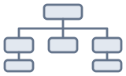
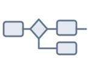

# 案图 · 诉讼可视化（`@zh-xx/antu-dsh`）

DeepSeek Harness 插件：在对话里用 Host 工具校验、排版并渲染法律图，聊天卡片可直接看图、打开全屏视图。产出是一份可离线打开、可归档转发的自包含 HTML（约 2.3 MB，不依赖服务器）。

当前为 **0.x**。事实图与程序图可日常使用；关系图、证成图的数据格式仍是草案，**证成图暂不发展**。许可证 [AGPL-3.0-or-later](https://github.com/zh-xx/Antu/blob/main/LICENSE)。

产品总览（引擎、JSON 规范、命令行）：[案图 README（中文）](https://github.com/zh-xx/Antu/blob/main/README.zh-CN.md) · [在线演示](https://zh-xx.github.io/Antu/)

## 能画什么

四类法律内容，同一份 JSON 可在页面里切换多种画法：

<table>
<tr><th rowspan="2" align="left" valign="middle">关系图</th><td align="center"><a href="https://github.com/zh-xx/Antu/blob/main/examples/relationship/marketplace-parties.zh-CN.json"><br>关系图</a></td><td align="center"><a href="https://github.com/zh-xx/Antu/blob/main/examples/relationship/marketplace-parties.zh-CN.json"><br>聚焦图</a></td><td align="center"><a href="https://github.com/zh-xx/Antu/blob/main/examples/relationship/marketplace-parties.zh-CN.json"><br>关系矩阵</a></td><td align="center"><a href="https://github.com/zh-xx/Antu/blob/main/examples/relationship/marketplace-parties.zh-CN.json"><br>股权图</a></td></tr>
<tr><td align="center"><a href="https://github.com/zh-xx/Antu/blob/main/examples/relationship/marketplace-parties.zh-CN.json"><br>控制与任职图</a></td><td align="center"><a href="https://github.com/zh-xx/Antu/blob/main/examples/relationship/marketplace-parties.zh-CN.json"><br>关联方清单</a></td><td align="center"><a href="https://github.com/zh-xx/Antu/blob/main/examples/relationship/marketplace-parties.zh-CN.json"><br>关系路径图</a></td></tr>
<tr><th align="left" valign="middle">事实图</th><td align="center"><a href="https://github.com/zh-xx/Antu/blob/main/examples/fact/neighbour-corridor-charging.zh-CN.json"><br>时间图</a></td><td align="center"><a href="https://github.com/zh-xx/Antu/blob/main/examples/fact/neighbour-corridor-charging.zh-CN.json"><br>大事记</a></td><td align="center"><a href="https://github.com/zh-xx/Antu/blob/main/examples/fact/neighbour-corridor-charging.zh-CN.json"><br>比例时间轴</a></td></tr>
<tr><th align="left" valign="middle">程序图</th><td align="center"><a href="https://github.com/zh-xx/Antu/blob/main/examples/procedure/05-premises-lease.zh-CN.json"><br>流程图</a></td><td align="center"><a href="https://github.com/zh-xx/Antu/blob/main/examples/procedure/05-premises-lease.zh-CN.json"><br>路线图</a></td></tr>
<tr><th align="left" valign="middle">证成图</th><td align="center"><a href="https://github.com/zh-xx/Antu/blob/main/examples/justification/fang-yuan-defense-excess.zh-CN.json"><br>说理树</a></td></tr>
</table>

- **程序图**：程序路径与可能分支
- **事实图**：时间、参与人、事件经过
- **关系图**：主体、角色与法律关系（七种画法；格式仍为草案）
- **证成图**：规范与事实到结论的推演（草案；暂不发展）

## 安装

npm 包：[`@zh-xx/antu-dsh`](https://www.npmjs.com/package/@zh-xx/antu-dsh)，版本与 [`@zh-xx/antu`](https://www.npmjs.com/package/@zh-xx/antu) **同号**。

在 DeepSeek Harness 中安装该包（插件管理 / Discover 选版本安装，或 CLI）：

```bash
dsh plugin --profile <配置名> add @zh-xx/antu-dsh
```

**要求**：DeepSeek Harness **≥ 0.2.0-rc.2**（聊天卡片依赖宿主的包内异步加载能力；更旧的 0.1.x 上 Host 工具仍可用，卡片会提示升级而不是白屏崩溃）。

也可从 [法橱 · LexCab](https://lexcab.nervonly.cn/) 的索引订阅后，在 Discover 里找到「案图 · 诉讼可视化」再安装。

## 装好之后

| 能力 | 说明 |
| --- | --- |
| Host 工具 | `antu_validate`（校验）、`antu_layout`（排版预估）、`antu_render`（写出 HTML） |
| 参考工具 | `antu_schema` / `antu_guide` / `antu_examples`（字段表、机制说明、示例） |
| 技能 | `antu-diagram`（教模型按案图约定出图） |
| 聊天卡片 | `antu_render` 完成后，对话里直接展示整图；可点开右侧全屏，切换画法与主题，导出 |

典型用法：把案件材料放进会话，请助手「画一张事实时间线 / 程序图 / 关系图」。助手调用工具写出 JSON 并渲染后，卡片出现在对话中；需要细看时打开全屏视图。界面语言跟随 DSH（中文 / English）；图内容本身不翻译。

主题可与宿主明暗模式配合：深色宿主用深色图；浅色宿主可用文书 / 现代 / 法律等主题。详见 [主题说明](https://github.com/zh-xx/Antu/blob/main/spec/theme.md)。
